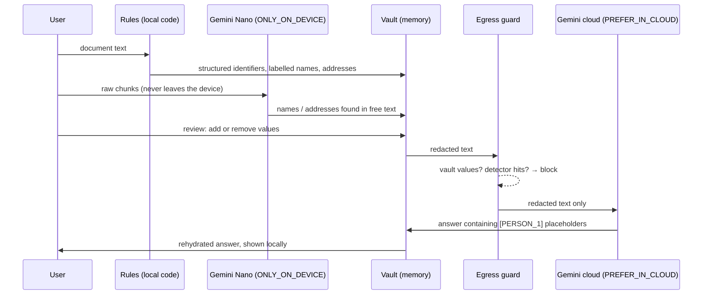

# Architecture

```
app/src
├── core/      Pure TypeScript. No SDK, no DOM. Everything the privacy promise depends on, fully unit-tested.
│   ├── rules.ts     Deterministic detectors (email, phone, card+Luhn, IBAN+mod97, IDs, DOB, labelled names, addresses)
│   ├── vault.ts     value ⇄ placeholder map ([PERSON_1]); apply / segments / rehydrate; lives in memory only
│   ├── egress.ts    Last check before any cloud-capable request; reports kinds and counts, never values
│   ├── policy.ts    Task → route table and the invariant "raw input ⇒ ON_DEVICE_ONLY"
│   ├── redact.ts    Rules first, then an injected on-device detector, chunked to fit Gemini Nano
│   ├── ledger.ts    Append-only record of where each AI step ran; sizes and counts only
│   └── chunk.ts     Paragraph/sentence chunking for the on-device context window
├── ai/        The only code that touches Firebase AI Logic.
│   ├── firebase.ts  initializeApp + App Check + getAI(GoogleAIBackend)
│   ├── models.ts    Route → InferenceMode; builds hybrid models (onDeviceParams / inCloudParams)
│   ├── run.ts       runTask(): egress guard → generateContent → inferenceSource → ledger
│   ├── tasks.ts     readImage, findEntities, triage, explain, followUp, prompts
│   ├── schemas.ts   JSON Schemas shared by the on-device and cloud backends
│   └── device.ts    Gemini Nano availability probe and download (via initializeDeviceModel)
├── state/     React hooks: session state machine, device status
└── ui/        Add / Review / Understand steps, Privacy Ledger, header chips
```

## Data flow



If the network is down, `PREFER_IN_CLOUD` falls back to Gemini Nano with a compact schema and a truncated, still-redacted
document (the SDK falls back on `FETCH_ERROR`, `ERROR` and `API_NOT_ENABLED`).

## Why these modes

| Concern | Decision |
|---|---|
| Raw data must never reach the cloud | `ONLY_ON_DEVICE` throws instead of falling back. The model is built with no `inCloudParams` at all. |
| Gemini Nano on web is single-turn, ~9k tokens, text + one image | Chunk the document; each follow-up is one self-contained prompt; images are read on-device only. |
| Gemini Nano may be missing (other browsers, weak hardware, not downloaded) | Rules still run; review requires explicit confirmation; explanations still work through the cloud on redacted text. |
| Same output shape on both backends | One JSON Schema → `responseConstraint` (on-device) and `responseJsonSchema` (cloud). |
| Default SDK session asks for image input | Text-only models declare only text inputs, so they work without the multimodal flag. |
| Proof, not promises | Ledger entries use the SDK-reported `inferenceSource`. A raw-data task that ran off-device has its result discarded. |

## Platform scope

The shipped target is **Web (Chrome)**. The routing policy in `core/policy.ts` is platform-neutral by design, so the same
table maps onto `OnDeviceConfig(mode = ...)` on Android and `HybridModel(primary:secondary:)` on iOS. Those ports are not part
of this submission.

## Testing

`npm test` runs Vitest: detectors against fictional documents, vault round-trips, the egress guard, the policy invariant, and
`runTask` against a fake hybrid model (blocked payloads never reach the model, the ledger reflects the reported source, raw-data
tasks that run in the cloud are rejected).
